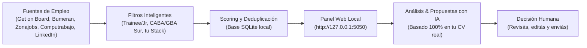

# Radar de Empleo 🎯
### Panel Local de Monitoreo y Asistente de Postulaciones IT
**Desarrollado para:** Santiago Agustín Rojas Casas  
**Objetivo:** Desarrollador Junior / Trainee (Full Stack • Node.js / React • Python • Cloud)  
**Alcance Geográfico:** CABA / Gran Buenos Aires (Zona Sur) • Modalidades Híbrida, Presencial y Remota.

---

## ⚡ Inicio Rápido

Hacé doble clic en **`iniciar_radar.bat`** (o ejecutá en tu terminal):

```powershell
python -m radar panel
```

El panel web se abrirá automáticamente en tu navegador en:  
👉 **`http://127.0.0.1:5050`**

---

## 🧭 ¿Qué hace el sistema?



1. **Rastreo Automático Multi-Portal:**  
   Monitorea en paralelo Get on Board, Bumeran, Zonajobs, Computrabajo Argentina y LinkedIn (en modo público para invitados, sin usar ni arriesgar tu cuenta personal).
2. **Filtro y Score por Reglas:**  
   Descarta ofertas Senior/Lead, roles no técnicos o zonas inaccesibles. Prioriza las que piden Node.js, Express, React, Python, Django, SQL o Cloud (AWS/GCP) y bonifica si están en CABA o Zona Sur.
3. **Control Total (Human-in-the-Loop):**  
   Organiza las ofertas por estados: **Nuevas**, **Me interesan**, **Postulé**, **Entrevista** y **Descartadas**.
4. **Análisis y Cartas con IA (Gemini):**  
   Con tu clave gratuita de Google Gemini (cargable desde la pestaña *Configuración* del panel), la IA analiza cada vacante, evalúa si es una oportunidad real para un perfil trainee, y redacta una propuesta a medida **utilizando únicamente datos reales de tu CV**.

---

## 💼 ¿Queda bien o mal tener este proyecto en GitHub?

> [!TIP]
> **Queda excelente, siempre que lo presentes como una herramienta de inteligencia y productividad, no como un bot de spam.**

### La diferencia clave que buscan los evaluadores:
* ❌ **Lo que queda mal:** Un script que manda 500 CVs automáticos a ciegas por LinkedIn. Los reclutadores odian eso porque es spam.
*  **Lo que impresiona a un Líder Técnico o Recruiter:** Un sistema full stack propio con arquitectura modular, base de datos relacional (SQLite), web scraping ético, consumo de APIs REST, panel web interactivo (Flask/HTML/CSS/JS) y orquestación con IA para análisis de datos y redacción asistida.

En tus entrevistas podés presentarlo así:  
> *"Construí 'Radar de Empleo', una aplicación local en Python y Flask que rastrea 5 portales de empleo simultáneamente, normaliza y deduplica las publicaciones en SQLite, calcula un score de compatibilidad con mi stack y utiliza IA para filtrar requisitos y redactar borradores de postulación."*

Esto demuestra que no sos un estudiante pasivo esperando que te llamen, sino un desarrollador proactivo que resuelve problemas reales con código.

---

## 🛠️ Estructura del Código

```plaintext
LABUBU/
├── iniciar_radar.bat           # Acceso directo para iniciar el panel
├── buscar_ofertas.bat          # Acceso directo para forzar una búsqueda
├── config.json                 # Configuración de búsqueda, palabras clave y filtros
├── .env                        # Clave de Gemini (local, ignorada por Git)
├── perfil/
│   └── cv.md                   # Fuente de verdad estricta para la IA
├── radar/                      # Código modular de la aplicación
│   ├── config.py               # Cargador de entorno y base de datos
│   ├── db.py                   # Esquema SQLite, consultas y tracking
│   ├── scoring.py              # Algoritmo de ponderación y filtrado por reglas
│   ├── runner.py               # Orquestador concurrente y programador
│   ├── ai.py                   # Cliente Gemini (REST API nativo)
│   ├── web.py                  # Servidor Flask y endpoints
│   ├── sources/                # Módulos de extracción
│   │   ├── getonbrd.py         # API pública Get on Board
│   │   ├── navent.py           # API interna de Bumeran y Zonajobs
│   │   ├── computrabajo.py     # Parser HTML Computrabajo Argentina
│   │   └── linkedin.py         # Endpoints públicos de LinkedIn Jobs
│   ├── templates/              # Vistas HTML (Jinja2)
│   │   ├── base.html
│   │   ├── index.html          # Tablero de ofertas y filtros
│   │   ├── job.html            # Detalle, análisis IA y redactor de cartas
│   │   └── config.html         # Panel de configuración y edición de CV
│   └── static/                 # CSS responsivo y JavaScript interactivo
└── tracking_postulaciones.md   # Registro manual complementario en Markdown
```

---

## 🔑 Activar la IA (Opcional pero muy recomendado)

1. Obtené una clave gratuita en [Google AI Studio](https://aistudio.google.com/apikey).
2. Abrí el panel local (`http://127.0.0.1:5050`) y andá a la pestaña **Configuración**.
3. Pegá tu clave en la sección **Inteligencia artificial (Gemini)** y guardá.  
   *(Se guardará de forma segura en tu `.env` local, sin subirse a ningún repositorio).*


## Resumen diario por correo

- Todos los días a las **08:00** la tarea de Windows *"Radar de Empleo - Resumen diario"* ejecuta `resumen_diario.bat`: busca ofertas y te manda por mail las **nuevas** que encajan con tu perfil (puntaje ≥ 60). Si la PC estaba apagada, corre cuando la prendas.
- Si el panel está abierto a esa hora, también lo envía él. Nunca se manda dos veces el mismo día y cada oferta se avisa una sola vez.
- Configuración: panel → **Configuración → Correo** (Gmail + contraseña de aplicación, guardados solo en `.env`).
- Consola: `python -m radar probar-mail` · `python -m radar resumen --forzar`
- Log: `%LOCALAPPDATA%\RadarEmpleo\resumen.log`
- Para desactivarlo: destildá "Resumen diario activado" o borrá la tarea en el Programador de tareas de Windows.


## Avisos por WhatsApp

Además del mail, el resumen puede llegar a tu WhatsApp con [CallMeBot](https://www.callmebot.com/blog/free-api-whatsapp-messages/) (gratis, uso personal: solo te manda mensajes a vos).

1. Activá CallMeBot desde tu WhatsApp siguiendo su guía; te devuelve una **apikey**.
2. Cargá `WHATSAPP_PHONE` (con código de país) y `CALLMEBOT_APIKEY` en tu `.env`, o desde el panel → **Configuración → WhatsApp**.
3. Probalo: `python -m radar probar-whatsapp` (o el botón del panel).

El mensaje trae la fecha, las 5 ofertas de mejor puntaje (con etiqueta, empresa, modalidad y link) y "+N más en tu mail". Si es largo se parte en varios mensajes con una pausa entre envíos. Los canales se eligen en `notificaciones.canales` (`["email", "whatsapp"]`); si uno falla se registra y se sigue con el otro.

> CallMeBot no publica el largo máximo ni los límites de envío, por eso `whatsapp_max_caracteres` (900) y `whatsapp_pausa_seg` (5) son configurables en `config.json`.


## Ejecución diaria en la nube (GitHub Actions)

Para recibir los avisos **aunque tu PC esté apagada**, el workflow `.github/workflows/radar-diario.yml` corre todos los días a las **8:17 (hora Argentina)** y también a mano desde la pestaña *Actions → Radar diario → Run workflow*.

**Cómo activarlo**

1. En el repo: *Settings → Secrets and variables → Actions* y cargá `GMAIL_USER`, `GMAIL_APP_PASSWORD`, `RADAR_DESTINATARIO`, `WHATSAPP_PHONE`, `CALLMEBOT_APIKEY` y, si querés IA, `GEMINI_API_KEY` (los de WhatsApp y Gemini son opcionales).
2. En `config.json`, poné `"modo": "ci"` en `notificaciones` y subí el cambio. Por defecto es `"local"`.
3. Corré el workflow a mano. Una segunda corrida no repite ofertas.

**`notificaciones.modo`** evita recibir avisos repetidos si usás las dos opciones: solo el entorno que coincide con el modo manda avisos. Con `"ci"`, la tarea programada de Windows y el panel no mandan el resumen (podés forzarlo a mano con `python -m radar resumen --forzar`); con `"local"`, GitHub Actions no manda nada.

**Cómo funciona**

- `python -m radar resumen --ci` corre sin panel ni navegador y los avisos no incluyen links al panel local.
- Cada corrida de GitHub arranca vacía, así que las ofertas ya avisadas se recuerdan en `notificados.json`, en la rama huérfana `radar-state`. Guarda **solo hashes** (nada de títulos, empresas ni el estado de tus postulaciones) y borra los de más de 45 días sin aparecer.
- Busca en `busqueda.fuentes_ci`, separada de `fuentes_activas`. **LinkedIn está desactivado ahí** porque suele bloquear las IPs de servidores. Una fuente que falla se registra y se saltea, nunca corta la corrida, y el resumen dice cuáles fallaron. Si algún canal de aviso falla, el workflow termina en rojo y GitHub te avisa por mail.

**⚠ Workflows programados en repos públicos:** GitHub los **desactiva automáticamente después de 60 días sin actividad** en el repositorio. Para reactivarlo: pestaña *Actions → Radar diario* y botón **Enable workflow** (o hacé un commit y volvé a correrlo a mano con *Run workflow*). Además, GitHub puede demorar unos minutos los jobs programados.
