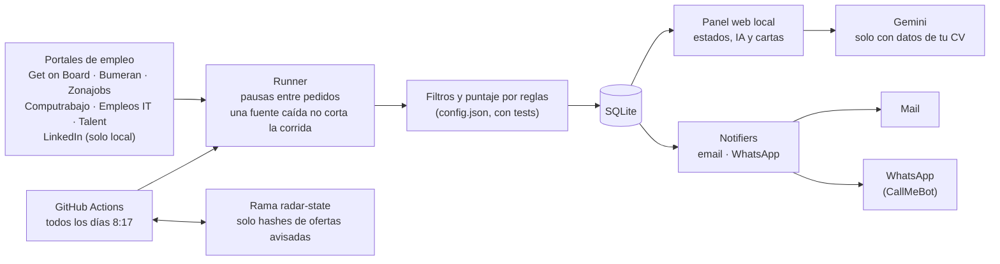

# Radar de Empleo 🎯

[](https://github.com/saos1739/ayudante-de-empleo/actions/workflows/tests.yml)

> **In short:** a Python/Flask tool that tracks junior IT job postings from Argentine job boards, filters and scores them against my profile with testable rules, and sends me a daily summary by email and WhatsApp.
> It can run locally (web dashboard) or in the cloud on a daily GitHub Actions schedule, even when my PC is off.
> It never applies on its own and never logs in to any portal; it is a decision-support tool, not a spam bot.

**Radar de Empleo** rastrea ofertas IT junior en portales argentinos, las filtra y puntúa contra mi perfil, las analiza con IA (Gemini) y me manda un resumen diario por **mail y WhatsApp**. Funciona como panel web local y, además, corre solo todos los días en **GitHub Actions** aunque mi PC esté apagada.

**Busco:** primer trabajo en IT como Desarrollador Full Stack / Frontend / Backend Jr o Trainee, Analista de Datos / BI Jr o Cloud Jr · CABA / GBA Sur (presencial o híbrido) o remoto.

---

## ⚡ Inicio rápido

Requiere Python 3.12.

```powershell
git clone https://github.com/saos1739/ayudante-de-empleo.git
cd ayudante-de-empleo
python -m venv .venv
.venv\Scripts\activate
pip install -r requirements.txt

copy .env.example .env                       # tus claves y contacto (nunca se versiona)
copy perfil\cv.example.md perfil\cv.md       # tu CV: la única fuente de verdad de la IA

python -m radar panel
```

El panel se abre en 👉 **http://127.0.0.1:5050** (también con `iniciar_radar.bat`). Desde **Configuración** cargás el CV, la clave de Gemini, el mail y WhatsApp.

---

## 🧭 ¿Qué hace?



1. **Rastreo multi-portal.** Recorre las fuentes una por una, con pausa entre pedidos. LinkedIn se consulta en modo público, sin cuenta.
2. **Filtro y puntaje por reglas** (`radar/scoring.py`): descarta Senior/Lead, roles no técnicos, inglés avanzado, 3+ años de experiencia y ofertas fuera de zona; suma por stack propio, junior/trainee y cercanía. Cada oferta queda con una etiqueta (**encaja** / **aplicá igual**) y sus motivos.
3. **Control con intervención humana.** Estados: Nueva, Me interesa, Postulé, Entrevista, Descartada.
4. **IA (Gemini, opcional).** Analiza cada oferta contra los 3 puestos objetivo y redacta propuestas usando **únicamente** lo que está en `perfil/cv.md`.
5. **Avisos** por mail y WhatsApp, locales o desde la nube.

### Reglas de filtrado

El stack propio, el ajeno y los puestos objetivo salen de `config.json` (`perfil.stack_core`, `perfil.stack_ajeno`, `perfil.puestos_objetivo`), así que actualizar el perfil no requiere tocar código.

| Situación | Resultado |
|---|---|
| 0–1 año de experiencia | normal |
| 2 años | se mantiene como **aplicá igual**, con penalización |
| 3 años o más | se excluye |
| Remoto desde el exterior que acepta Argentina / LATAM / "anywhere" | se mantiene, penalización leve |
| Presencial o híbrido fuera de Argentina, o exige residir en otro país | se excluye |
| Inglés intermedio / intermedio-avanzado / upper intermediate (B2) | alcanza |
| Inglés avanzado, fluido, bilingüe, C1 o C2 | se excluye |
| Part time o freelance | resta puntos, no excluye |
| Sin tecnología de mi stack ni puesto objetivo | se descarta |

---

## 💼 Decisiones de diseño y uso responsable

- **No postula solo.** Ninguna función envía una postulación. La herramienta ordena, puntúa y redacta borradores; la decisión y el envío son siempre humanos.
- **No inicia sesión en ningún portal.** Usa solo páginas y endpoints públicos; no usa ni arriesga cuentas personales.
- **Respeta pausas entre pedidos** (`busqueda.pausa_entre_pedidos_seg`, 1,2 s por defecto), y pide el detalle de una oferta solo si pasó el primer filtro. En la nube no vuelve a procesar lo que ya avisó.
- **Datos personales fuera del repo.** El CV, el teléfono, el mail, las postulaciones y las claves viven en archivos ignorados por git (`.env`, `perfil/cv.md`, …) o en GitHub Secrets. El repo solo trae versiones de ejemplo (`*.example.md`) con datos ficticios, y el estado de la nube guarda únicamente hashes.
- **La IA no inventa.** El prompt le exige usar solo el CV; si algo no está ahí, no lo afirma.
- **Claves sin filtrarse.** Los errores de WhatsApp se traducen a mensajes propios porque la excepción de `requests` incluye la URL con la apikey, y en los logs de Actions de un repo público quedaría expuesta.

---

## 🖥️ Uso local

| Comando | Qué hace |
|---|---|
| `python -m radar panel` | abre el panel web |
| `python -m radar buscar` | una búsqueda |
| `python -m radar resumen` | busca y manda el resumen (`--forzar` para reenviar) |
| `python -m radar probar-mail` | mail de prueba |
| `python -m radar probar-whatsapp` | mensaje de prueba por WhatsApp |
| `python -m radar recalcular` | recalcula puntajes tras cambiar filtros |
| `python -m pytest` · `ruff check .` | tests y lint |

**Resumen diario en Windows.** Una tarea del Programador de tareas ejecuta `resumen_diario.bat` todos los días a las 08:00 (si la PC estaba apagada, corre cuando la prendés). Si el panel está abierto a esa hora, también lo envía él. Cada oferta se avisa una sola vez. Log: `%LOCALAPPDATA%\RadarEmpleo\resumen.log`.

### Avisos por mail

Panel → **Configuración → Correo**: Gmail con una [contraseña de aplicación](https://myaccount.google.com/apppasswords) (no tu contraseña normal), guardada solo en `.env`.

### Avisos por WhatsApp

Usa [CallMeBot](https://www.callmebot.com/blog/free-api-whatsapp-messages/): gratis, uso personal, solo te manda mensajes a vos.

1. Activá CallMeBot desde tu WhatsApp siguiendo su guía; te devuelve una **apikey**.
2. Cargá `WHATSAPP_PHONE` (con código de país) y `CALLMEBOT_APIKEY` en `.env`, o desde **Configuración → WhatsApp**.
3. Probalo con `python -m radar probar-whatsapp`.

El mensaje trae la fecha, las 5 ofertas de mejor puntaje (puntaje, etiqueta, título, empresa, modalidad y link) y "+N más en tu mail". Si supera el largo máximo se parte en varios mensajes con una pausa entre envíos. Los canales se eligen en `notificaciones.canales`; si uno falla se registra y se sigue con el otro, y una oferta queda avisada si llegó por al menos uno.

> CallMeBot no publica el largo máximo ni los límites de envío, por eso `whatsapp_max_caracteres` (900) y `whatsapp_pausa_seg` (5) son configurables.

### Activar la IA (opcional)

1. Sacá una clave gratuita en [Google AI Studio](https://aistudio.google.com/apikey).
2. Pegala en **Configuración → Inteligencia artificial** (se guarda en tu `.env`).

---

## ☁️ Uso en la nube (GitHub Actions)

Para recibir los avisos **aunque tu PC esté apagada**, el workflow [`radar-diario.yml`](.github/workflows/radar-diario.yml) corre todos los días a las **8:17 (hora Argentina)** y también a mano desde *Actions → Radar diario → Run workflow*.

**Cómo activarlo**

1. En el repo: *Settings → Secrets and variables → Actions* y cargá `GMAIL_USER`, `GMAIL_APP_PASSWORD`, `RADAR_DESTINATARIO`, `WHATSAPP_PHONE`, `CALLMEBOT_APIKEY` y, si querés IA, `GEMINI_API_KEY` (WhatsApp y Gemini son opcionales).
2. En `config.json`, poné `"modo": "ci"` en `notificaciones` y subí el cambio. Por defecto es `"local"`.
3. Corré el workflow a mano. Una segunda corrida no repite ofertas.

**`notificaciones.modo`** evita recibir avisos repetidos si usás las dos opciones: solo el entorno que coincide con el modo manda avisos. Con `"ci"`, la tarea de Windows y el panel no mandan el resumen (se puede forzar con `python -m radar resumen --forzar`); con `"local"`, GitHub Actions no manda nada.

**Cómo funciona**

- `python -m radar resumen --ci` corre sin panel ni navegador, y los avisos no incluyen links al panel local.
- Cada corrida de GitHub arranca vacía, así que las ofertas ya avisadas se recuerdan en `notificados.json`, en la rama huérfana `radar-state`. Guarda **solo hashes** (ni títulos, ni empresas, ni el estado de mis postulaciones) y olvida los de más de 45 días sin aparecer.
- Busca en `busqueda.fuentes_ci`, separada de `fuentes_activas`. **LinkedIn está desactivado ahí** porque suele bloquear IPs de servidores. Una fuente que falla se registra y se saltea, nunca corta la corrida, y el resumen dice cuáles fallaron. Si un canal de aviso falla, el workflow termina en rojo (GitHub suele avisarlo por mail, según tus notificaciones).

> ⚠ **GitHub desactiva los workflows programados de repos públicos después de 60 días sin actividad.** Para reactivarlo: *Actions → Radar diario* y botón **Enable workflow** (o un commit y una corrida manual con *Run workflow*). GitHub además puede demorar unos minutos los jobs programados.

---

## 🔐 Variables de entorno

Se leen del entorno o de `.env` (copiá `.env.example`). En la nube, de GitHub Secrets.

| Variable | Para qué | Obligatoria |
|---|---|---|
| `GMAIL_USER` | cuenta Gmail que envía el resumen | para el mail |
| `GMAIL_APP_PASSWORD` | contraseña de aplicación de Google | para el mail |
| `RADAR_DESTINATARIO` | quién recibe el mail (si falta, `GMAIL_USER`) | no |
| `WHATSAPP_PHONE` | tu teléfono con código de país | para WhatsApp |
| `CALLMEBOT_APIKEY` | apikey de CallMeBot | para WhatsApp |
| `GEMINI_API_KEY` | análisis y cartas con IA | no |
| `CANDIDATO_TELEFONO`, `CANDIDATO_EMAIL` | contacto que firma las cartas (si faltan, se toma de `perfil/cv.md`) | no |
| `RADAR_DB` | ruta de la base SQLite (por defecto `%LOCALAPPDATA%\RadarEmpleo\radar.db`) | no |
| `RADAR_ESTADO` | ruta del `notificados.json` en la nube (la fija el workflow) | solo en CI |

---

## 🛠️ Estructura del código

```plaintext
ayudante-de-empleo/
├── .github/workflows/
│   ├── radar-diario.yml            # búsqueda y avisos diarios en la nube
│   └── tests.yml                   # ruff + pytest en cada push y PR
├── radar/
│   ├── sources/                    # una clase por portal (heredan de base.py)
│   ├── notifiers/                  # canales de aviso con interfaz común
│   │   ├── base.py                 #   interfaz Notificador y Resultado
│   │   ├── email.py                #   Gmail SMTP
│   │   ├── whatsapp.py             #   canal + proveedor (CallMeBot)
│   │   └── formato.py              #   datos de cada oferta para los avisos
│   ├── scoring.py                  # filtro y puntaje por reglas
│   ├── runner.py                   # orquesta las fuentes
│   ├── ai.py                       # análisis y cartas con Gemini
│   ├── ci.py, estado_ci.py         # corrida diaria en la nube y su estado
│   ├── db.py, config.py, util.py   # SQLite, configuración, utilidades
│   ├── web.py, templates/, static/ # panel Flask
├── scripts/gestor_postulaciones.py # registro de postulaciones en Markdown
├── tests/                          # pytest, sin pedidos reales a internet
├── docs/specs/radar-v2.md          # especificación de la v2
├── perfil/cv.example.md            # plantilla del CV (el real es perfil/cv.md, ignorado)
├── config.json                     # palabras clave, filtros, perfil, IA y notificaciones
├── .env.example                    # variables de entorno, sin valores
├── requirements.txt, requirements-dev.txt, ruff.toml
└── *.bat                           # accesos directos para Windows
```

---

## ✅ Tests y calidad

```powershell
pip install -r requirements-dev.txt
ruff check .
python -m pytest
```

Los tests cubren las reglas del scoring (con avisos de ejemplo), el formato y la partición de los mensajes, los notifiers con SMTP y HTTP simulados, el estado entre corridas y los workflows. **Ningún test hace pedidos a internet**: la suite bloquea los sockets, así que un test que olvide el mock falla en lugar de pegarle a un portal. `tests.yml` corre `ruff` y `pytest` en cada push y pull request.

---

## 🧩 Stack y lo que aprendí

**Stack:** Python 3.12 · Flask + Jinja2 · SQLite · requests + BeautifulSoup · API REST de Gemini · Gmail SMTP · CallMeBot · GitHub Actions · pytest + ruff.

- **Reglas como datos, con tests.** Mover el stack y los puestos a `config.json` y escribir un test por regla hizo que ajustar los filtros sea seguro y que un cambio de perfil no toque código.
- **Separar canal de proveedor.** El formato y la partición de mensajes no dependen de CallMeBot, así que cambiarlo por Twilio o la Meta Cloud API es sumar una clase.
- **Procesos sin memoria.** Una corrida de Actions arranca vacía, así que el estado "qué ya avisé" viaja en una rama aparte, solo con hashes, con vencimiento y sin repetir avisos.
- **Los errores también filtran secretos.** La URL con la apikey aparece en las excepciones de `requests`; la solución fue traducirlas y cubrirlo con un test.
- **Tolerar fallos parciales.** Una fuente o un canal caído no cortan la corrida: se informa y se sigue, y solo se marca como avisado lo que de verdad llegó.

---

## 👤 Autor

**Santiago Rojas** · [LinkedIn](https://www.linkedin.com/in/rojasantiagoa) · [GitHub](https://github.com/saos1739)
