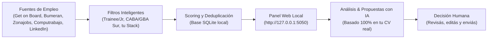

# Radar de Empleo 🎯
### Panel Local de Monitoreo y Asistente de Postulaciones IT
**Desarrollado para:** Santiago Agustín Rojas Casas  
**Objetivo:** Desarrollador Junior / Trainee (Full Stack • Node.js / React • Python • Cloud)  
**Alcance Geográfico:** CABA / Gran Buenos Aires (Zona Sur) • Modalidades Híbrida, Presencial y Remota.

---

## ⚡ Inicio Rápido

Hacé doble clic en **`iniciar_radar.bat`** (o ejecutá en tu terminal):

```powershell
python -m radar panel
```

El panel web se abrirá automáticamente en tu navegador en:  
👉 **`http://127.0.0.1:5050`**

---

## 🧭 ¿Qué hace el sistema?



1. **Rastreo Automático Multi-Portal:**  
   Monitorea en paralelo Get on Board, Bumeran, Zonajobs, Computrabajo Argentina y LinkedIn (en modo público para invitados, sin usar ni arriesgar tu cuenta personal).
2. **Filtro y Score por Reglas:**  
   Descarta ofertas Senior/Lead, roles no técnicos o zonas inaccesibles. Prioriza las que piden Node.js, Express, React, Python, Django, SQL o Cloud (AWS/GCP) y bonifica si están en CABA o Zona Sur.
3. **Control Total (Human-in-the-Loop):**  
   Organiza las ofertas por estados: **Nuevas**, **Me interesan**, **Postulé**, **Entrevista** y **Descartadas**.
4. **Análisis y Cartas con IA (Gemini):**  
   Con tu clave gratuita de Google Gemini (cargable desde la pestaña *Configuración* del panel), la IA analiza cada vacante, evalúa si es una oportunidad real para un perfil trainee, y redacta una propuesta a medida **utilizando únicamente datos reales de tu CV**.

---

## 💼 ¿Queda bien o mal tener este proyecto en GitHub?

> [!TIP]
> **Queda excelente, siempre que lo presentes como una herramienta de inteligencia y productividad, no como un bot de spam.**

### La diferencia clave que buscan los evaluadores:
* ❌ **Lo que queda mal:** Un script que manda 500 CVs automáticos a ciegas por LinkedIn. Los reclutadores odian eso porque es spam.
*  **Lo que impresiona a un Líder Técnico o Recruiter:** Un sistema full stack propio con arquitectura modular, base de datos relacional (SQLite), web scraping ético, consumo de APIs REST, panel web interactivo (Flask/HTML/CSS/JS) y orquestación con IA para análisis de datos y redacción asistida.

En tus entrevistas podés presentarlo así:  
> *"Construí 'Radar de Empleo', una aplicación local en Python y Flask que rastrea 5 portales de empleo simultáneamente, normaliza y deduplica las publicaciones en SQLite, calcula un score de compatibilidad con mi stack y utiliza IA para filtrar requisitos y redactar borradores de postulación."*

Esto demuestra que no sos un estudiante pasivo esperando que te llamen, sino un desarrollador proactivo que resuelve problemas reales con código.

---

## 🛠️ Estructura del Código

```plaintext
LABUBU/
├── iniciar_radar.bat           # Acceso directo para iniciar el panel
├── buscar_ofertas.bat          # Acceso directo para forzar una búsqueda
├── config.json                 # Configuración de búsqueda, palabras clave y filtros
├── .env                        # Clave de Gemini (local, ignorada por Git)
├── perfil/
│   └── cv.md                   # Fuente de verdad estricta para la IA
├── radar/                      # Código modular de la aplicación
│   ├── config.py               # Cargador de entorno y base de datos
│   ├── db.py                   # Esquema SQLite, consultas y tracking
│   ├── scoring.py              # Algoritmo de ponderación y filtrado por reglas
│   ├── runner.py               # Orquestador concurrente y programador
│   ├── ai.py                   # Cliente Gemini (REST API nativo)
│   ├── web.py                  # Servidor Flask y endpoints
│   ├── sources/                # Módulos de extracción
│   │   ├── getonbrd.py         # API pública Get on Board
│   │   ├── navent.py           # API interna de Bumeran y Zonajobs
│   │   ├── computrabajo.py     # Parser HTML Computrabajo Argentina
│   │   └── linkedin.py         # Endpoints públicos de LinkedIn Jobs
│   ├── templates/              # Vistas HTML (Jinja2)
│   │   ├── base.html
│   │   ├── index.html          # Tablero de ofertas y filtros
│   │   ├── job.html            # Detalle, análisis IA y redactor de cartas
│   │   └── config.html         # Panel de configuración y edición de CV
│   └── static/                 # CSS responsivo y JavaScript interactivo
└── tracking_postulaciones.md   # Registro manual complementario en Markdown
```

---

## 🔑 Activar la IA (Opcional pero muy recomendado)

1. Obtené una clave gratuita en [Google AI Studio](https://aistudio.google.com/apikey).
2. Abrí el panel local (`http://127.0.0.1:5050`) y andá a la pestaña **Configuración**.
3. Pegá tu clave en la sección **Inteligencia artificial (Gemini)** y guardá.  
   *(Se guardará de forma segura en tu `.env` local, sin subirse a ningún repositorio).*


## Resumen diario por correo

- Todos los días a las **08:00** la tarea de Windows *"Radar de Empleo - Resumen diario"* ejecuta `resumen_diario.bat`: busca ofertas y te manda por mail las **nuevas** que encajan con tu perfil (puntaje ≥ 60). Si la PC estaba apagada, corre cuando la prendas.
- Si el panel está abierto a esa hora, también lo envía él. Nunca se manda dos veces el mismo día y cada oferta se avisa una sola vez.
- Configuración: panel → **Configuración → Correo** (Gmail + contraseña de aplicación, guardados solo en `.env`).
- Consola: `python -m radar probar-mail` · `python -m radar resumen --forzar`
- Log: `%LOCALAPPDATA%\RadarEmpleo\resumen.log`
- Para desactivarlo: destildá "Resumen diario activado" o borrá la tarea en el Programador de tareas de Windows.
